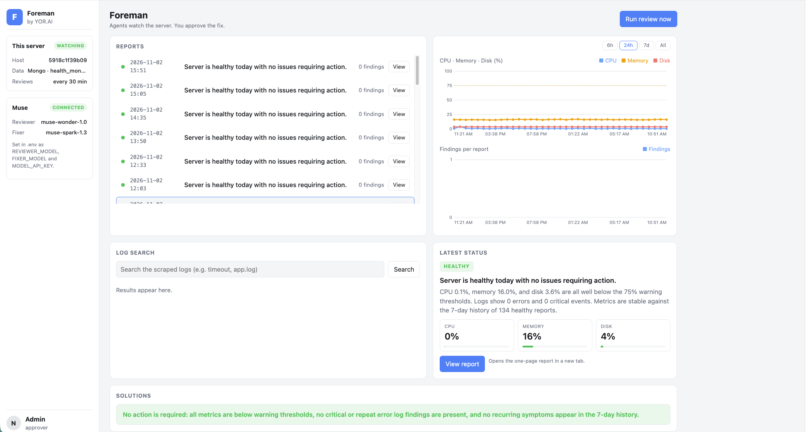

# Foreman

**Agents watch the server. You approve the fix.**

Foreman is an autonomous system administrator built from AI agents on Meta's models. Two collectors gather a server's metrics and logs every 30 minutes. A Reviewer agent reads them against the last seven days of history and writes a one-page health report. Any finding that needs action goes to a Fixer agent, which proposes an executable, reversible fix with its side effects named. A human approves it from the dashboard. The result is recorded, so the next review knows what was done and whether it worked.

Built for the Meta Global AI Developer Hackathon (Oct 27 to Nov 4, 2026), startup track, problem statement "Build for Your World."



## What it does

A sysadmin's morning usually starts with the same questions: is anything wrong, is it new, and what should I do about it. Foreman answers all three before they ask. It does not act on its own. Every fix is proposed with a plain-language explanation, the exact commands, the risk, the rollback, and what else it touches. The admin clicks Apply or Rerun. Rerun rejects the proposal and asks for a different approach, with a note on how the new one compares to the old.

The loop:

```
Server --> Chip (metrics, via Muse CLI) --\
                                          +--> Reviewer (muse-wonder-1.0) --> report --> Admin
       --> Chuck (log scraper, no AI) ----/          |                                    |
                                               The Fixer (muse-spark-1.3) <--- Rerun -----+
                                                     |                                    |
                                               FixProposal ------------ Apply ------------+--> store
```

## Meta models, and where each one sits

| Role | Model | Why |
| --- | --- | --- |
| Chip (metrics) | Muse CLI, `muse exec` | Collects CPU, memory, disk, top processes and asks Muse for a first-pass health read. Local psutil fallback if Muse is unavailable. |
| Reviewer | `muse-wonder-1.0` via Meta Model API | Reasons over today's metrics, a digest of the logs, and seven days of prior reports and fixes. Writes the report. |
| The Fixer | `muse-spark-1.3` via Meta Model API | Fast and cheap per call. Proposes one executable fix per finding. |
| Executor | shell, or `muse exec --trust-workspace` | Applies an approved fix. Nothing runs until Apply is pressed. |

Both agents are Pydantic AI agents with structured output. One finding worth sharing: Meta Model API's native JSON mode (`response_format` with a JSON schema) drops fields that have default values from the returned object. The Reviewer's `findings` list came back empty even when the headline named three issues. The repo's `probe` command reproduces it. Both agents now use prompted output with validation and a retry guardrail instead, which fixed it.

## Built during the hackathon

Everything in this repository was written between Oct 27 and Nov 4, 2026:

- `chip.py`, `chuck.py`, `mongo_store.py` and the cron scheduler container (collection side)
- `core/`, `config/`, `prompts/`, `main.py`, `ui/` and the Docker build (agents, API, dashboard)

There is no pre-existing codebase underneath it.

## Quick start

```bash
cp .env.example .env            # add MODEL_API_KEY
docker compose up -d --build
open http://localhost:8000
```

That starts three containers: MongoDB (`db`), a cron scheduler that runs Chip and Chuck every 30 minutes (`scheduler`), and Foreman with the API and dashboard on port 8000 (`foreman`). Foreman's own scheduler reviews every 30 minutes whenever new collector data has landed, so the loop runs with nobody touching it.

```bash
docker compose logs -f foreman                    # watch each review land
curl -X POST localhost:8000/api/tick?force=true   # review now instead of waiting
```

Compressed demo clock: set `FOREMAN_REVIEW_INTERVAL_MIN: "1"` in `docker-compose.yml` and the cycle plays out every minute.

### Without Docker

```bash
pip install -r requirements.txt
cp .env.example .env
FOREMAN_MOCK=1 python main.py test                      # sample data, no API key needed
FOREMAN_MOCK=1 python main.py test --scenario healthy   # the "no action required" path
python main.py test                                     # same, on the real Meta models
cd ui && npm install && npm run build && cd ..
python main.py serve                                    # http://localhost:8000
```

Other commands:

```bash
python main.py review                      # review the newest Chip and Chuck data
python main.py review --source mongo       # Mongo only, fail loudly if it's down
python main.py rerun fix_xxx               # reject a fix, get a different approach
python main.py apply fix_xxx               # run it, record the result
python main.py history                     # what the Reviewer reads next run
python main.py probe                       # compare native vs prompted structured output on the live model
```

## Layout

```
foreman/
├── chip.py                 metrics via Muse CLI  -> health.json, Mongo health_results
├── chuck.py                log scraper (no AI)   -> logs.json, Mongo log_summaries + logs
├── mongo_store.py          collectors -> MongoDB
├── run_all.sh, crontab, scheduler-entrypoint.sh, Dockerfile-backend   the cron container
├── main.py                 CLI: test | review | apply | rerun | serve | history | probe
├── config/settings.py      .env -> Settings
├── core/
│   ├── schemas.py          every record: ChipCheck, ChuckCheck, Finding, FixProposal, Report, FixRecord
│   ├── agents.py           reviewer_agent + fixer_agent (Pydantic AI, Meta Model API) and guardrails
│   ├── inputs.py           newest Chip/Chuck from Mongo, data/inbox files as fallback
│   ├── digest.py           groups Chuck's raw lines into normalized errors for the Reviewer
│   ├── pipeline.py         run_review, rerun_fix, apply_fix
│   ├── scheduler.py        reviews on an interval, only when inputs changed
│   ├── executor.py         runs approved fixes (shell or muse exec)
│   ├── report.py           one-page HTML report
│   ├── store.py            MongoDB, or JSON files in data/db/ when MONGO_URI is empty
│   ├── mock_models.py      FOREMAN_MOCK=1 stand-ins
│   └── api.py              FastAPI, serves the dashboard
├── prompts/
│   ├── reviewer.xml        what the Reviewer looks for and how it writes
│   └── fixer.xml           what The Fixer may propose, and the rerun rules
├── data/
│   ├── inbox/              health.json and logs.json land here
│   ├── samples/            example inputs for testing
│   └── reports/            rendered HTML
├── ui/                     React + Vite dashboard
├── Dockerfile, docker-compose.yml
└── .env.example
```

## How the pieces fit

**Collection.** Chip collects real metrics with psutil, injects them into a prompt, and runs `muse exec --trust-workspace` non-interactively. It parses Muse's JSON reply into `health.json`; if Muse times out or returns no JSON, it computes the status locally so the file is always valid. Chuck searches the OS log locations (or paths you give it), parses timestamps and levels, reads only the tail of large files, handles gzipped rotations, and writes `logs.json` sorted newest first with a summary of counts by level. Both run from cron inside the `scheduler` container and store their results through `mongo_store.py`.

**Inputs.** `core/inputs.py` reads the newest Chip and Chuck results from Mongo (`health_results`, `log_summaries`, `logs`) and rebuilds the exact file shapes. If Mongo is unreachable it reads `data/inbox/*.json`. `FOREMAN_INPUT` picks the behavior: `auto`, `mongo`, or `file`.

**Digest.** Chuck has no AI and returns up to 500 raw lines per file. `core/digest.py` groups errors by normalized message (timestamps, numbers, request ids stripped) with counts and first and last seen, and keeps the newest eight. The Reviewer sees the digest, not raw lines, which keeps the prompt small and the grouping deterministic.

**Review.** The Reviewer gets the metrics, the digest, and a history window: prior reports, open findings, applied and rejected fixes. It writes a status, headline, summary, per-finding evidence and impact, a trend tag for each finding, and marks which findings need a fix.

**Fix.** For each finding marked `needs_fix`, The Fixer proposes a title, explanation, ordered steps with commands, risk, side effects, and rollback. On Rerun it also writes a "versus previous" note.

**Guardrails in code, regardless of what the model says.** The Reviewer can't call a server healthy when a metric is over threshold, and must return at least one finding when it says warning or critical. The Fixer can't propose banned commands (`mkfs`, `iptables`, `passwd`, `dd` to a device, and so on) and `rm` is only allowed under `/tmp`, `/var/tmp`, `/var/log`, and `/var/cache`. A disallowed proposal triggers a retry with the reason; a Fixer failure never sinks the report.

**Store.** Reports, findings, and fixes go to the same MongoDB as the collectors, in their own collections. Applied, failed, and rejected fixes are what the Reviewer reads as history next time.

**Dashboard.** Reports list with one-click View of the HTML report, metric graphs with hover values and a 6h / 24h / 7d range, log search across stored reports, latest status, and a Solutions panel with one row per finding: issue, proposed fix, Apply, Rerun.

## Tuning the agents

Edit `prompts/reviewer.xml` and `prompts/fixer.xml`. Thresholds, focus areas, history rules, report rules, allowed fix families, banned commands, and rerun rules live there. The XML is loaded fresh on every run and mounted into the container, so a change takes effect on the next review with no rebuild.

## API

| Method | Path | What |
| --- | --- | --- |
| GET | `/api/health` | Models, Mongo status, review interval, hostname |
| POST | `/api/run` | Review now |
| POST | `/api/tick?force=` | Scheduler pass on demand |
| GET | `/api/reports`, `/api/reports/latest`, `/api/reports/{id}`, `/api/reports/{id}/html` | Reports |
| GET | `/api/metrics` | CPU, memory, disk, findings per report |
| GET | `/api/logs/search?q=` | Search scraped log lines across reports |
| POST | `/api/fixes/{id}/apply` | Approve and run a fix, record the result |
| POST | `/api/fixes/{id}/rerun` | Reject a fix, get a different one |
| GET | `/api/fixes` | Fix history |

FastAPI publishes the OpenAPI spec at `/openapi.json`.

## Configuration

`.env` keys, all with defaults in `config/settings.py`:

| Key | Default | Meaning |
| --- | --- | --- |
| `MODEL_API_KEY` | | Meta Model API key |
| `MODEL_API_BASE_URL` | `https://api.meta.ai/v1` | OpenAI-compatible endpoint |
| `REVIEWER_MODEL` | `muse-wonder-1.0` | |
| `FIXER_MODEL` | `muse-spark-1.3` | |
| `FOREMAN_MOCK` | `0` | `1` runs with local stand-in models |
| `MONGO_URI` | | Empty means JSON files in `data/db/` |
| `MONGO_DB` | `health_monitor` | |
| `FOREMAN_INPUT` | `auto` | `auto`, `mongo`, or `file` |
| `FOREMAN_EXECUTOR` | `shell` | `shell` or `muse` |
| `FOREMAN_REVIEW_INTERVAL_MIN` | `0` | Built-in scheduler; `0` is off |
| `FOREMAN_HISTORY_DAYS` | `7` | History window for the Reviewer |

## Collector reference

### Chip

```bash
python chip.py                                   # default system_health prompt
python chip.py --prompt quick|detailed|disk
python chip.py --output health.json --timeout 60 --debug
python chip.py --install-only
```

Output schema: `status` (healthy, warning, critical), `timestamp`, `summary`, `cpu_percent`, `memory_percent`, `disk_percent`, `issues[]`, `recommendations[]`, `_source` (`muse` or local fallback). Thresholds: warning above 75%, critical above 90%.

Muse is run as `muse exec --trust-workspace "<prompt>"`. Passing the prompt as a bare argument opens the interactive TUI and hangs; `exec` mode is required for non-interactive use. Metrics are injected with `.replace("__METRICS__", ...)` rather than `.format()`, which breaks on JSON braces.

### Chuck

```bash
python chuck.py                                  # OS default log paths, last 24 hours
python chuck.py --path /var/log --hours 1
python chuck.py --level ERROR --keyword "timeout" --output errors.json
python chuck.py --no-save | jq '.summary'
```

Options: `--path` (repeatable), `--hours` (0 = no limit), `--level`, `--keyword`, `--max-files` (50), `--max-lines` (500, from the end of each file), `--include-null-timestamps`. Lines with no parseable timestamp are dropped by default so every entry sorts and filters by time. Recognizes `.log`, `.txt`, `.out`, `.err`, `.log.gz`, plus `syslog`, `messages`, `auth.log`, `system.log`. Stdlib only.

Output: `timestamp`, `host`, `system`, `search_paths`, `hours_searched`, `summary` (`total_entries`, `files_scanned`, `by_level`, `errors`, `warnings`), `files[]`, `logs[]` with `file`, `line`, `timestamp`, `level`, `message`.

## Known limits

- `FOREMAN_EXECUTOR=shell` applies fixes inside the Foreman container. On a real deployment Foreman runs as a sidecar on the host it watches.
- Some system logs are root-only. Chuck skips files it can't read. The compose file mounts `/var/log` read-only into the scheduler container.
- Chip's Muse CLI call needs a Muse login inside the scheduler container (`docker compose exec scheduler muse login`). Without it, Chip falls back to local metrics and the pipeline still runs.

## License

MIT
