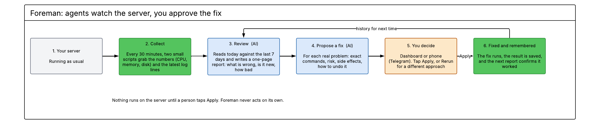
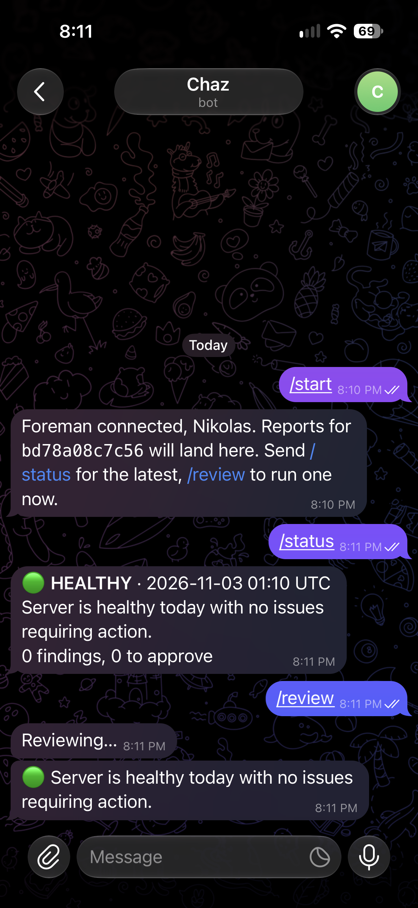
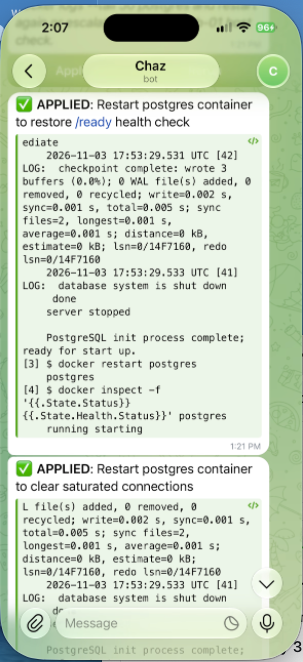

<p align="center">
  
</p>

<h3 align="center">Agents watch the server. You approve the fix.</h3>

<p align="center">
  Built on <b>muse-wonder-1.0</b> and <b>muse-spark-1.3</b> via Meta Model API, with the Muse CLI on the collection side.<br>
  Meta Global AI Developer Hackathon 2026, startup track.
</p>

---

Foreman is an autonomous system administrator built from AI agents on Meta's models. Two collectors gather a server's metrics and logs every 30 minutes. A Reviewer agent reads them against the last seven days of history and writes a one-page health report. Any finding that needs action goes to a Fixer agent, which proposes an executable, reversible fix with its side effects named. A human approves it from the dashboard, or from their phone. The result is recorded, so the next review knows what was done and whether it worked.

Built for the Meta Global AI Developer Hackathon (Oct 27 to Nov 4, 2026), problem statement "Build for Your World."

## How it works



Six steps, two of them AI, one of them you.

1. **Your server** runs as usual. Foreman sits next to it.
2. **Collect.** Every 30 minutes two small scripts grab the numbers (CPU, memory, disk) and the newest log lines. No AI here, just facts.
3. **Review.** The Reviewer agent reads today against the last seven days and writes a one-page report: what's wrong, whether it's new or recurring, how bad.
4. **Propose a fix.** For each finding that needs action, the Fixer agent writes the exact commands, the risk, the side effects, and how to undo it.
5. **You decide.** On the dashboard or on your phone. Tap Apply, or Rerun for a different approach.
6. **Fixed and remembered.** The fix runs, the result is saved, and the next report confirms whether it worked. If it didn't, the Reviewer says so and the Fixer won't propose it again.

Nothing runs on the server until a person taps Apply.


## Try it in 60 seconds

You need Docker and a Meta Model API key. Nothing else.

```bash
cp .env.example .env                  # paste your key into MODEL_API_KEY. Every other value is a working default.
docker compose up -d --build          # MongoDB + collectors on cron + Foreman with the dashboard
open http://localhost:8000
```

The server will be healthy, which is boring. Give it something to find:

```bash
python server_status_dummy_logs.py --count 100 --output ./demo-logs/test.log --seed 7   # a postgres outage, in log form
docker compose exec scheduler sh /app/run_all.sh                                        # collect now instead of waiting for cron
curl -X POST 'localhost:8000/api/tick?force=true'                                       # review now
```

About 20 seconds later the dashboard shows a red report: findings with evidence, a proposed fix under each one, and Apply / Rerun buttons. The postgres fix will say `docker restart postgres`, because compose also starts a small postgres container for exactly this. Click Apply. The fix runs, the output comes back, the state flips to APPLIED.

Then prove it worked:

```bash
python server_status_dummy_logs.py --count 60 --output ./demo-logs/test.log --seed 19   # clean logs this time
docker compose exec scheduler sh /app/run_all.sh
curl -X POST 'localhost:8000/api/tick?force=true'
```

The next report comes back healthy, and its trend line says the postgres failures stopped after the applied restart. Break, fix, verify: that's the whole product.

No API key yet? `FOREMAN_MOCK=1` in `.env` runs the same pipeline on local stand-in models.

## What it does

A sysadmin's morning usually starts with the same questions: is anything wrong, is it new, and what should I do about it. Foreman answers all three before they ask. It does not act on its own. Every fix is proposed with a plain-language explanation, the exact commands, the risk, the rollback, and what else it touches. The admin clicks Apply or Rerun. Rerun rejects the proposal and asks for a different approach, with a note on how the new one compares to the old.

Foreman remembers. A fix that failed shows up in the next review as "tried, didn't work," and the Fixer is told not to propose it again. A finding that keeps coming back is tagged recurring with the date it first appeared. And when the problem is somewhere Foreman can't reach, the Fixer says so and returns a manual step instead of inventing a command.

## Reports on your phone (optional)



Foreman can send every report to Telegram, with Apply and Rerun buttons under each proposed fix. Tap Apply on the couch, the fix runs on the server, the result comes back in the chat. No public URL and no extra container; Foreman polls Telegram from inside the one it already runs in.

Three steps, two minutes:

1. In Telegram, message `@BotFather`, send `/newbot`, pick a name. Copy the token it gives you.
2. Put it in `.env` as `TELEGRAM_BOT_TOKEN=...` and restart: `docker compose up -d foreman`.
3. Open your new bot in Telegram and send `/start`. Foreman replies "Foreman connected" and remembers the chat.

From then on, reports with findings arrive on their own. `/status` shows the latest report, `/review` runs one now. Healthy reports stay quiet unless you set `TELEGRAM_NOTIFY=all`. The chat is remembered across restarts; set `TELEGRAM_CHAT_ID` in `.env` if you want to pin it.

<br clear="all">

<p align="center">
  &nbsp;&nbsp;
  
</p>

## Meta models, and where each one sits

| Role | Model | Why |
| --- | --- | --- |
| Chip (metrics) | Muse CLI, `muse exec` | Collects CPU, memory, disk, top processes and asks Muse for a first-pass health read. Local psutil fallback if Muse is unavailable. |
| Reviewer | `muse-wonder-1.0` via Meta Model API | Reasons over today's metrics, a digest of the logs, and seven days of prior reports and fixes. Writes the report. |
| The Fixer | `muse-spark-1.3` via Meta Model API | Fast and cheap per call. Proposes one executable fix per finding. |
| Executor | shell, or `muse exec --trust-workspace` | Applies an approved fix. Nothing runs until Apply is pressed. |

Both agents are Pydantic AI agents with structured output. One finding worth sharing: Meta Model API's native JSON mode (`response_format` with a JSON schema) drops fields that have default values from the returned object. The Reviewer's `findings` list came back empty even when the headline named three issues. The repo's `probe` command reproduces it. Both agents now use prompted output with validation and a retry guardrail instead, which fixed it.

## Built during the hackathon

Everything in this repository was written between Oct 27 and Nov 4, 2026:

- `chip.py`, `chuck.py`, `mongo_store.py`, `server_status_dummy_logs.py` and the cron scheduler container (collection side)
- `core/`, `config/`, `prompts/`, `main.py`, `ui/`, the Telegram bot and the Docker build (agents, API, dashboard, phone)

There is no pre-existing codebase underneath it.

## Running it

`docker compose up -d --build` starts four containers: MongoDB (`db`), a cron scheduler that runs Chip and Chuck every 30 minutes (`scheduler`), Foreman with the API and dashboard on port 8000 (`foreman`), and a small `postgres` so the demo has a real service to restart. Foreman gets the host's Docker socket, which is how an approved `docker restart` reaches the other containers. Foreman's own scheduler reviews every 30 minutes whenever new collector data has landed, so the loop runs with nobody touching it.

```bash
docker compose logs -f foreman                      # watch each review land
curl -X POST 'localhost:8000/api/tick?force=true'   # review now instead of waiting
docker compose exec scheduler muse login            # one time: lets Chip use the Muse CLI instead of its local fallback
```

Compressed demo clock: set `FOREMAN_REVIEW_INTERVAL_MIN: "1"` in `docker-compose.yml` and the cycle plays out every minute.

### Without Docker

```bash
pip install -r requirements.txt
cp .env.example .env
FOREMAN_MOCK=1 python main.py test                      # sample data, no API key needed
FOREMAN_MOCK=1 python main.py test --scenario healthy   # the "no action required" path
python main.py test                                     # same, on the real Meta models
cd ui && npm install && npm run build && cd ..
python main.py serve                                    # http://localhost:8000
```

Other commands:

```bash
python main.py review                      # review the newest Chip and Chuck data
python main.py review --source mongo       # Mongo only, fail loudly if it's down
python main.py rerun fix_xxx               # reject a fix, get a different approach
python main.py apply fix_xxx               # run it, record the result
python main.py history                     # what the Reviewer reads next run
python main.py probe                       # compare native vs prompted structured output on the live model
```

## Layout

```
foreman/
├── chip.py                 metrics via Muse CLI  -> health.json, Mongo health_results
├── chuck.py                log scraper (no AI)   -> logs.json, Mongo log_summaries + logs
├── mongo_store.py          collectors -> MongoDB
├── server_status_dummy_logs.py   synthetic outage logs for demos and tests
├── run_all.sh, crontab, scheduler-entrypoint.sh, Dockerfile-backend   the cron container
├── main.py                 CLI: test | review | apply | rerun | serve | history | probe
├── config/settings.py      .env -> Settings
├── core/
│   ├── schemas.py          every record: ChipCheck, ChuckCheck, Finding, FixProposal, Report, FixRecord
│   ├── agents.py           reviewer_agent + fixer_agent (Pydantic AI, Meta Model API) and guardrails
│   ├── inputs.py           newest Chip/Chuck from Mongo, data/inbox files as fallback
│   ├── digest.py           groups Chuck's raw lines into normalized errors for the Reviewer
│   ├── pipeline.py         run_review, rerun_fix, apply_fix
│   ├── scheduler.py        reviews on an interval, only when inputs changed
│   ├── executor.py         runs approved fixes (shell or muse exec)
│   ├── notify.py           Telegram: report to the phone, Apply / Rerun from the chat
│   ├── report.py           one-page HTML report
│   ├── store.py            MongoDB, or JSON files in data/db/ when MONGO_URI is empty
│   ├── mock_models.py      FOREMAN_MOCK=1 stand-ins
│   └── api.py              FastAPI, serves the dashboard
├── prompts/
│   ├── reviewer.xml        what the Reviewer looks for and how it writes
│   └── fixer.xml           what The Fixer may propose, and the rerun rules
├── data/
│   ├── inbox/              health.json and logs.json land here
│   ├── samples/            example inputs for testing
│   └── reports/            rendered HTML
├── demo-logs/              where the dummy log script writes; mounted into the scheduler
├── ui/                     React + Vite dashboard
├── Dockerfile, docker-compose.yml
└── .env.example
```

## How the pieces fit

**Collection.** Chip collects real metrics with psutil, injects them into a prompt, and runs `muse exec --trust-workspace` non-interactively. It parses Muse's JSON reply into `health.json`; if Muse times out or returns no JSON, it computes the status locally so the file is always valid. Chuck searches the log paths you give it, parses timestamps and levels, reads only the tail of large files, handles gzipped rotations, and writes `logs.json` sorted newest first with a summary of counts by level. Both run from cron inside the `scheduler` container and store their results through `mongo_store.py`.

**Inputs.** `core/inputs.py` reads the newest Chip and Chuck results from Mongo (`health_results`, `log_summaries`, `logs`) and rebuilds the exact file shapes. If Mongo is unreachable it reads `data/inbox/*.json`. `FOREMAN_INPUT` picks the behavior: `auto`, `mongo`, or `file`.

**Digest.** Chuck has no AI and returns up to 500 raw lines per file. `core/digest.py` groups errors by normalized message (timestamps, numbers, request ids stripped) with counts and first and last seen, and keeps the newest eight. The Reviewer sees the digest, not raw lines, which keeps the prompt small and the grouping deterministic.

**Review.** The Reviewer gets the metrics, the digest, and a history window: prior reports, open findings, applied and rejected fixes. It writes a status, headline, summary, per-finding evidence and impact, a trend tag for each finding, and marks which findings need a fix.

**Fix.** For each finding marked `needs_fix`, The Fixer proposes a title, explanation, ordered steps with commands, risk, side effects, and rollback. On Rerun it also writes a "versus previous" note. It is told what kind of host it's writing for (`FOREMAN_HOST_KIND`): on a container host it gets the live list of running containers and uses `docker ps`, `docker logs`, `docker restart`, `docker inspect`; on a systemd host it uses `systemctl`. When the finding points at a machine it can't reach, it returns a single `echo MANUAL` step and explains what the admin has to do by hand.

**Guardrails in code, regardless of what the model says.** The Reviewer can't call a server healthy when a metric is over threshold, and must return at least one finding when it says warning or critical. The Fixer can't propose banned commands (`mkfs`, `iptables`, `passwd`, `dd` to a device, and so on), `rm` is only allowed under `/tmp`, `/var/tmp`, `/var/log`, and `/var/cache`, and it can never restart, stop, or kill Foreman's own containers (`foreman`, `health_db`, `health_scheduler`). A disallowed proposal triggers a retry with the reason; a Fixer failure never sinks the report.

**Apply.** Approved steps run in order and stop at the first failure. Exit codes and output are captured, the fix is recorded as applied or failed, and the report and Telegram message update. A failed fix is history too: the Reviewer sees it next run and the Fixer is told not to propose it again. Inside compose, Foreman has the Docker socket, so a `docker restart` acts on the real containers next to it; that's the same shape as a sidecar on a production host.

**Store.** Reports, findings, and fixes go to the same MongoDB as the collectors, in their own collections.

**Dashboard.** Reports list with one-click View of the HTML report, metric graphs with hover values, click-to-select, and a 6h / 24h / 7d range, log search across stored reports, latest status, and a Solutions panel with one row per finding: issue, proposed fix, Apply, Rerun.

## Tuning the agents

Edit `prompts/reviewer.xml` and `prompts/fixer.xml`. Thresholds, focus areas, history rules, report rules, allowed fix families, banned commands, and rerun rules live there. The XML is loaded fresh on every run and mounted into the container, so a change takes effect on the next review with no rebuild.

## API

| Method | Path | What |
| --- | --- | --- |
| GET | `/api/health` | Models, Mongo and Telegram status, review interval, hostname |
| POST | `/api/run` | Review now |
| POST | `/api/tick?force=` | Scheduler pass on demand |
| GET | `/api/reports`, `/api/reports/latest`, `/api/reports/{id}`, `/api/reports/{id}/html` | Reports |
| GET | `/api/metrics` | CPU, memory, disk, findings per report |
| GET | `/api/logs/search?q=` | Search scraped log lines across reports |
| POST | `/api/fixes/{id}/apply` | Approve and run a fix, record the result |
| POST | `/api/fixes/{id}/rerun` | Reject a fix, get a different one |
| GET | `/api/fixes` | Fix history |

FastAPI publishes the OpenAPI spec at `/openapi.json`.

## Configuration

`.env` keys. `.env.example` carries every default, so the only required edit is the API key.

| Key | Default | Meaning |
| --- | --- | --- |
| `MODEL_API_KEY` | | Meta Model API key. Required. |
| `MODEL_API_BASE_URL` | `https://api.meta.ai/v1` | OpenAI-compatible endpoint |
| `REVIEWER_MODEL` | `muse-wonder-1.0` | |
| `FIXER_MODEL` | `muse-spark-1.3` | |
| `FOREMAN_MOCK` | `0` | `1` runs with local stand-in models, no key needed |
| `MONGO_URI` | | Empty means JSON files in `data/db/`. Compose sets `mongodb://db:27017`. |
| `MONGO_DB` | `health_monitor` | |
| `FOREMAN_INPUT` | `auto` | `auto`, `mongo`, or `file` |
| `FOREMAN_EXECUTOR` | `shell` | `shell` or `muse` |
| `FOREMAN_HOST_KIND` | `docker` | What the Fixer assumes about the host: `docker` (services are containers) or `systemd` |
| `FOREMAN_REVIEW_INTERVAL_MIN` | `0` | Built-in scheduler; `0` is off. Compose sets 30. |
| `FOREMAN_HISTORY_DAYS` | `7` | History window for the Reviewer |
| `FOREMAN_SERVER_NAME` | hostname | Label on reports, dashboard and Telegram |
| `TELEGRAM_BOT_TOKEN` | | Optional. From `@BotFather`. Empty means Telegram is off. |
| `TELEGRAM_CHAT_ID` | | Optional. `/start` records it; set here to pin it. |
| `TELEGRAM_NOTIFY` | `issues` | `issues` sends reports with findings; `all` sends every report |

## Collector reference

### Chip

```bash
python chip.py                                   # default system_health prompt
python chip.py --prompt quick|detailed|disk
python chip.py --output health.json --timeout 60 --debug
python chip.py --install-only
```

Output schema: `status` (healthy, warning, critical), `timestamp`, `summary`, `cpu_percent`, `memory_percent`, `disk_percent`, `issues[]`, `recommendations[]`, `_source` (`muse` or local fallback). Thresholds: warning above 75%, critical above 90%.

Muse is run as `muse exec --trust-workspace "<prompt>"`. Passing the prompt as a bare argument opens the interactive TUI and hangs; `exec` mode is required for non-interactive use. Metrics are injected with `.replace("__METRICS__", ...)` rather than `.format()`, which breaks on JSON braces.

### Chuck

```bash
python chuck.py                                  # OS default log paths, last 24 hours
python chuck.py --path /var/log --hours 1
python chuck.py --level ERROR --keyword "timeout" --output errors.json
python chuck.py --no-save | jq '.summary'
```

Options: `--path` (repeatable), `--hours` (0 = no limit), `--level`, `--keyword`, `--max-files` (50), `--max-lines` (500, from the end of each file), `--include-null-timestamps`. Lines with no parseable timestamp are dropped by default so every entry sorts and filters by time. Recognizes `.log`, `.txt`, `.out`, `.err`, `.log.gz`, plus `syslog`, `messages`, `auth.log`, `system.log`. Stdlib only.

Output: `timestamp`, `host`, `system`, `search_paths`, `hours_searched`, `summary` (`total_entries`, `files_scanned`, `by_level`, `errors`, `warnings`), `files[]`, `logs[]` with `file`, `line`, `timestamp`, `level`, `message`.

### Dummy logs

`server_status_dummy_logs.py` writes realistic JSON log lines (health checks, resource snapshots, HTTP requests, service events) with short random outages. `--seed` makes a run repeatable; `--count`, `--interval` and `--start` control volume and timing. The compose file mounts `./demo-logs` into the scheduler, so regenerating the file is enough; no rebuild.

## Known limits

- Fixes run from inside the Foreman container. With the Docker socket mounted (compose does this) it can restart any container on the host. It cannot restart a bare-metal service on the host, and `/proc/sys` is read-only to it, so the Fixer is told not to propose sysctl or cache-drop fixes on a container host. On a systemd host, set `FOREMAN_HOST_KIND=systemd` and run Foreman as a sidecar.
- The Fixer only acts on this host. Findings that come from logs about other machines (the demo logs mention `web-01`, `web-02`) get a manual step, not a command.
- Some system logs are root-only. Chuck skips files it can't read. The compose file mounts `/var/log/asl` read-only for macOS hosts; on Linux, mount `/var/log` the same way.
- Chip's Muse CLI call needs a Muse login inside the scheduler container (`docker compose exec scheduler muse login`). Without it, Chip falls back to local metrics and the pipeline still runs.

## License

MIT
